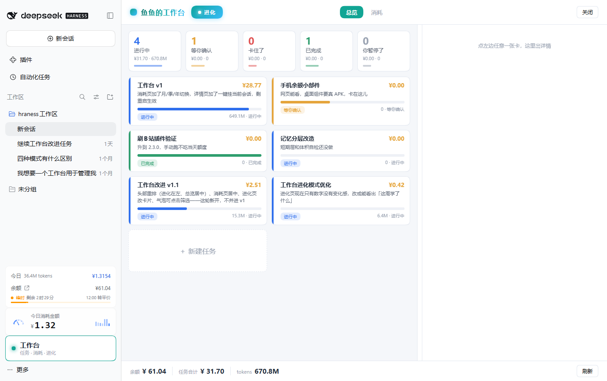
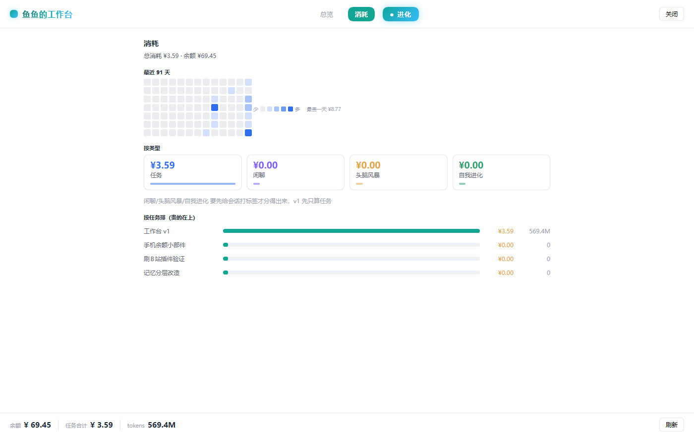
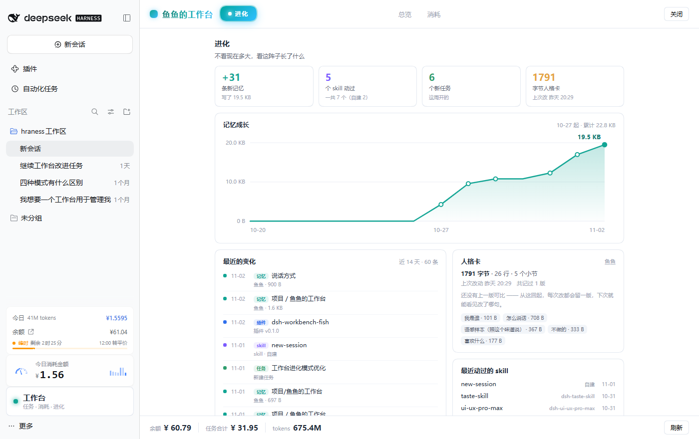
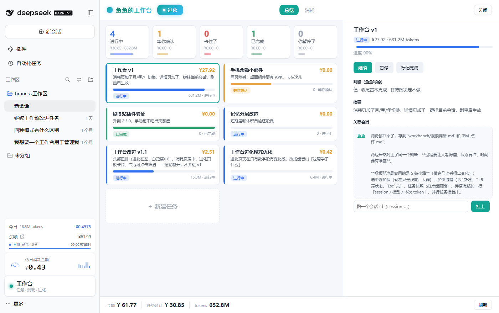

# 鱼鱼的工作台 · dsh-workbench-fish

给 [DeepSeek Harness](https://github.com/deepseek-ai/deepseek-harness) 用的任务看板插件：**一屏看清今天交给我多少活、跑到哪了、花了多少钱**。

不是项目管理软件，是个「每天回来看一眼」的每日站会视图。



## 它长什么样

左边是我的活，右边点开看详情，中间那条能拖，想专心看哪边就拖大哪边。底下一行余额和今日花费。

| 消耗 | 进化 | 详情 |
|---|---|---|
|  |  |  |

## 功能

**总览**
- 五个状态气泡：进行中 / 等你确认 / 卡住 / 已完成 / 你暂停了，点哪个就只看哪类
- 每个气泡、每张卡都带这小子花了多少钱、烧了多少 token
- 任务卡有状态色条、一句话摘要、进度条
- 底部一块「＋ 新建任务」，填个名字和摘要就进台账

**详情**
- 判断（我为什么接这活）、摘要、关联会话
- 进度条 + 继续 / 暂停 / 标记完成
- **能直接看完整对话**——把那张卡挂的会话内容解出来显示，不用跳走

**消耗**
- 最近 91 天热力图（一天一格，越蓝那天花得越多）
- 按类型拆（任务 / 闲聊 / 头脑风暴 / 自我进化）
- 按任务排，贵的在上

**进化**
- 不看现在多大，看这阵子长了什么：新记忆条数、动过几个 skill、开了几个任务
- 记忆增长曲线（按天）
- 最近 14 天的变化流水：改了哪条记忆、装了哪个插件、建了哪张卡
- 人格卡分段（我是谁 / 怎么说 / 语感样本 / 不做 / 喜欢 各占多少字节）

## 装

```bash
dsh plugin --profile web add dsh-workbench-fish
```

重启一次 `dsh web` 生效。入口在左侧栏底部，一块写着「工作台」的卡片。

## 数据怎么来的

- **任务**：存 `<DSH_HOME>/workbench-fish/tasks.json`，原子写（先写 .tmp 再 rename）
- **花费**：从 `dsh-cost-meter` 的账本 `<DSH_HOME>/storages/cost-meter/ledger.json` 按会话归集，再按任务挂的会话 id 分摊
- **对话内容**：直接读会话日志 `<DSH_HOME>/sessions/**/session.v4.jsonl.zstd`，注意这是多帧 zstd 拼接，必须逐帧解
- **余额**：调 DeepSeek 官方 `/user/balance`

## 接口

挂在 `ctx.webServer`，前缀 `/workbench-fish`，认证复用 `connection.requestRejection`。

| 路由 | 说明 |
|---|---|
| `GET /workbench-fish/state` | 一把取齐：任务 + 汇总 + 余额 + 进化 + 当前会话 |
| `POST /workbench-fish/tasks` | 建任务（无 id）或改任务（带 id） |
| `POST /workbench-fish/tasks/:id/status` | 只改状态 |
| `DELETE /workbench-fish/tasks/:id` | 删任务 |
| `GET /workbench-fish/daily?days=91` | 逐日花费（热力图用） |
| `GET /workbench-fish/session?id=…&limit=60` | 读某个会话的对话内容 |
| `GET /workbench-fish/authurl` | 返回带进程 token 的 GUI 地址（自动化测试用，仅本机 probe 可调） |

## 开发

改完代码**不用重启**：

1. 宿主（`lib/index.js`）：`dev_clear_routes('/workbench-fish')` → `dev_reload_package('workbench-fish')`，状态应为 `[active]`
2. 客户端（`lib/client.js`）：刷新页面

前提是装了 [`dsh-super-injector`](https://github.com/r-ayin/dsh-super-injector)（热注入 + 热重载）。没装的话改宿主得重启 `dsh web`。

```bash
# 自测：拿带 token 的地址截图
node ../im/tools/shot.mjs <token-url> out.png [overview|cost|evo|card|drag|newtask]
```

## 设计上的几个决定

- **颜色只表示状态**，不做装饰。状态色：进行中 `#2f6fed` / 等确认 `#e5a53c` / 卡住 `#e05252` / 完成 `#2f9e6e` / 暂停 `#9aa3b2`，强调色青绿 `#12a594`
- **不用「AI 产品默认紫」**，那个太容易撞模板
- **一屏一件事**：左边列表、右边详情，不做第四层
- **数字等宽右对齐**，列表滚动时不跳

## 已知限制

- 一个会话只能算给一张卡。跨任务的对话切不开，所以历史任务可能是 ¥0
- 「按类型」目前只有「任务」有数，另外三类要先给会话打标签
- 移动端没做单栏降级，窄屏会挤
- 没有测试

## License

MIT
